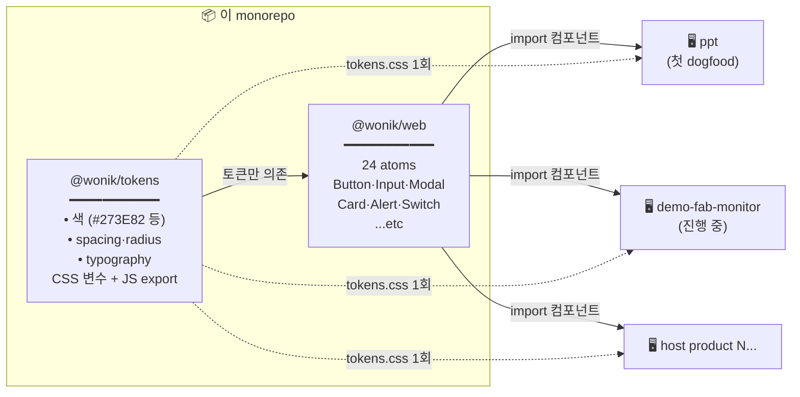
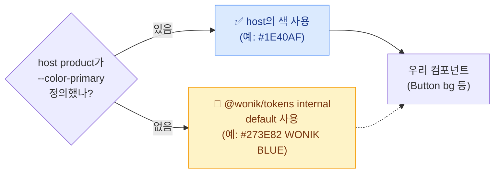

# WONIK IPS Design System

원익IPS 사내 web service 전체에서 사용하는 디자인 시스템 모노레포. WARP HMI 시안에서 추출한 토큰을 base로 한 `@wonik/tokens` + `@wonik/web` 두 패키지.

> **상태**: Phase 1 — Layer A atoms 24개 완료 (Button, Input, Card, Alert, Switch, Modal, Table 외). React 18/19 dual peer. 사내 npm registry 결정 전(IT 협의 진행 중) — 현재는 monorepo workspace + vendor tarball만 지원. 외부 publish는 ADR-018 이후.

---

## 큰 그림 한장



토큰이 컴포넌트에 흘러가고, 컴포넌트가 사내 host product 여러 개에 import됨. host는 자기 색을 갖고 싶으면 7개 interface 변수만 덮어쓰면 됨 (아래 cascade 섹션 참조).

---

## 60초 시작

> 본격 사용 가이드는 [`docs/QUICKSTART.md`](docs/QUICKSTART.md), 설치는 [`docs/INSTALL.md`](docs/INSTALL.md). 본 섹션은 빠른 미리보기.

```bash
# host product에서 (사내 registry URL 확정 후)
pnpm add @wonik/web @wonik/tokens
```

```tsx
// host product의 app entry (예: src/main.tsx) — 1회만
import '@wonik/tokens/tokens.css';
```

```tsx
// 어느 컴포넌트 파일에서나
import { Button, Card, Stack } from '@wonik/web';

export function MyView() {
  return (
    <Card padding="md">
      <Stack gap={3}>
        <Button variant="primary">저장</Button>
      </Stack>
    </Card>
  );
}
```

---

## 필요 환경

- **React**: 18.x 또는 19.x (dual peer — host의 React 그대로 사용, dedupe 불필요)
- **번들러**: Vite / Next.js / Webpack 5+ (ESM + CJS 양쪽 지원)
- **CSS**: Tailwind v4 host 또는 raw CSS 변수 consumer 둘 다 가능 (토큰은 CSS 변수로 노출)
- **패키지 매니저**: pnpm 권장 (이 repo의 표준). npm / yarn도 작동
- **TypeScript**: 5.x 권장 (5.7+에서 검증)

> ⚠️ React 17 이하는 미지원. Tailwind v3 host도 작동하지만 권장 환경은 v4.

---

## Docs map (어디서 뭘 찾나)

| 목적 | 문서 |
|---|---|
| **설치하고 싶다** | [`docs/INSTALL.md`](docs/INSTALL.md) — `.npmrc`, 사내 registry, scope 분리 |
| **매일 사용하고 싶다** | [`docs/QUICKSTART.md`](docs/QUICKSTART.md) — 5단계 매번 루틴 + cheat sheet + FAQ |
| **컴포넌트 시각 확인** | Storybook ([`apps/storybook`](apps/storybook)) — `pnpm -F storybook-app dev` |
| **왜 이 결정을 했는지** | [`docs/ADR.md`](docs/ADR.md) — 27개 ADR, 토큰·아키텍처·cascade·React 19 결정 |
| **product 사양·전체 그림** | [`docs/PRD.md`](docs/PRD.md), [`docs/ARCHITECTURE.md`](docs/ARCHITECTURE.md) |
| **시각 언어 가이드** | [`docs/UI_GUIDE.md`](docs/UI_GUIDE.md) — anti-pattern 9개 + brand tone |
| **변경 이력** | [`packages/web/CHANGELOG.md`](packages/web/CHANGELOG.md), [`packages/tokens/CHANGELOG.md`](packages/tokens/CHANGELOG.md) |
| **로드맵** | [`docs/ROADMAP.md`](docs/ROADMAP.md) |
| **기여** | `CONTRIBUTING.md` *(예정 — ADR-027 cycle 중 작성)* |

---

## 제공 컴포넌트 (`@wonik/web` v1.0.0)

24 atoms (+ `ThemeProvider`). 모두 `interfaceColors.*` cascade로 host theme override 지원 (ADR-010).

- **Layout**: `Box`, `Stack`, `Card`
- **Typography**: `Text`, `InlineEditableText`
- **Form**: `Button`, `IconButton`, `Input`, `Textarea`, `Checkbox`, `Switch`, `Radio`, `FilterChip`
- **Feedback**: `Alert`, `Toast` (+ `ToastProvider`, `useToast`), `Spinner`, `Skeleton`, `ProgressBar`
- **Overlay**: `Modal`, `Tooltip`
- **Data display**: `Badge`, `Avatar`, `Table`
- **Interaction**: `SortableList`
- **Theme**: `ThemeProvider`, `useTheme`

전체 props는 IDE 자동완성 또는 `packages/web/src/{Component}/types.ts`.

## 제공 토큰 (`@wonik/tokens` v1.0.0)

`colors` / `typography` / `spacing` / `radius` / `status` named export. CSS 변수도 함께 (`@wonik/tokens/tokens.css`). DTCG 1:1 호환 (ADR-020).

WONIK CI 색: **#273E82** (BLUE, primary) + **#ACACAC** (GRAY, secondary) — ADR-007.

---

## host 색 덮어쓰기 (cascade)

host product가 자체 색을 갖고 있으면 7개 interface 변수만 정의하면 자동으로 우리 컴포넌트가 그 색을 따라감.



```css
:root {
  --color-bg: #FAFAFA;
  --color-surface: #FFFFFF;
  --color-border: #E5E5E5;
  --color-text: #111111;
  --color-text-muted: #6B7280;
  --color-primary: #1E40AF;
  --color-focus: #3B82F6;
}
```

전부 정의해도 좋고, 일부만 정의해도 좋음. 미정의 변수는 우리 internal default로 fallback. 자세한 contract는 [`docs/ADR.md`](docs/ADR.md) ADR-010/011.

---

## 개발 (이 repo 안에서 작업할 때)

```bash
pnpm install                          # 1회

pnpm -F @wonik/tokens build           # 토큰 빌드
pnpm -F @wonik/web build              # web 빌드 (tokens build 후)
pnpm build                            # 전체

pnpm -F @wonik/web test               # 테스트
pnpm -F storybook-app dev             # Storybook 시각 확인 (localhost:6006)

pnpm lint                             # ESLint
pnpm changeset                        # 변경 항목 추가 (publish 전 필수)
```

상세는 [`CLAUDE.md`](CLAUDE.md).

---

## License

UNLICENSED — 원익IPS 사내 use only. 외부 배포 금지.

---

## 다음 dogfood / 로드맵

- **첫 dogfood**: `ppt` (Factory PPT, 진행 중) — 13 trial 완료
- **두 번째 dogfood**: `demo-fab-monitor` (진행 중)
- **Phase 2 (잠정)**: Layer A 2차 채움 (host product needs 3회 evidence 누적 후), 사내 registry publish, 다크 모드

진행 상황: [`docs/ROADMAP.md`](docs/ROADMAP.md).
